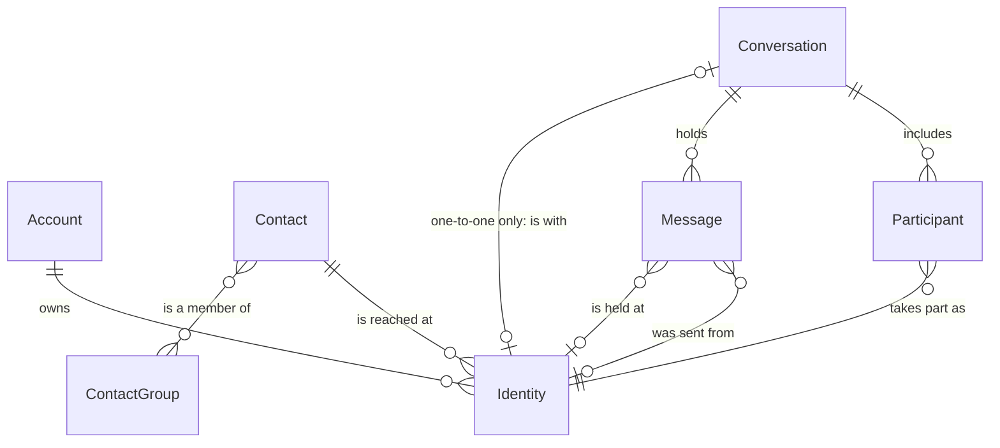
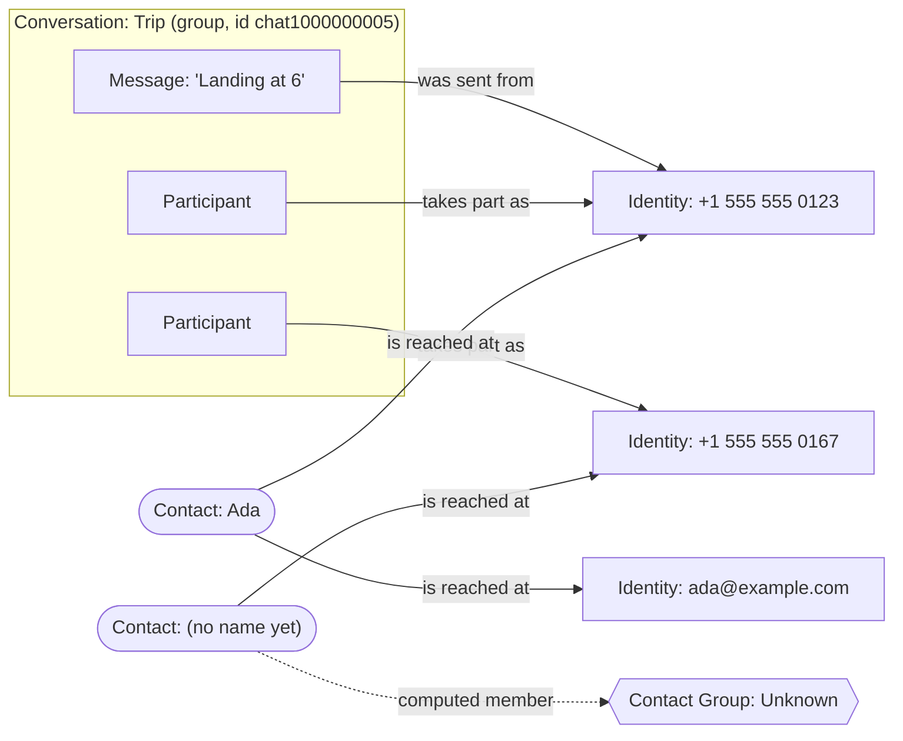

# Contacts, identities and messages

The people model: who Message Crate knows, how they are reached, and how
conversations and messages attach to them. This page shows the entities and
their relationships, draws one group chat out, and maps each piece to its
code. The constraints a change must keep are in
[Contacts, identities and messages: rules](rules/contacts-identities-and-messages.md).

[How contacts are made and changed](how-contacts-are-made-and-changed.md)
follows an import and an address book load step by step, with a diagram for
each decision.

## Two words for one thing

An **identity** is one address a person is reached at: a phone number, an
email address, or a username on a service. The app and the published
documentation, the HTTP API and the conversation file say identity. The
database and the server code over it say **handle** (`handles`,
`contact_handles`). They are the same thing. This document says
identity and gives the code name where it helps.

## The relationships

Each line reads left to right. A bar means exactly one, a circle means none is
allowed, and a crow's foot means many.

| Relationship | What it means |
|---|---|
| Account owns Identity | An account's identity is one of the account holder's own addresses: the messages from it belong to the holder (`account_handles`). This is ownership, where a contact's identity is participation; [CONTACT-50](rules/contacts-identities-and-messages.md#contact-50-an-accounts-own-identity-means-ownership-and-its-message-counts-describe-the-messages-it-holds) and [CONTACT-53](rules/contacts-identities-and-messages.md#contact-53-an-import-never-adds-an-account-identity) say how Import applies it. `account_handles` is the one store of an account's phone numbers and email addresses: the profile's `emails` and `phones` read it, and `phones` holds each number once with every service it is an identity under, and two accounts can each hold the same address, as two people can share a family email. |
| Contact is reached at Identity | A contact is one person and gathers any number of identities under one name. An identity belongs to at most one contact (`contact_handles`, keyed on the handle). |
| Conversation includes Participant | A participant is one other person's seat in one conversation, and keeps what that backup called them there (`participants.name_alias`). The account holder is never a participant; [CONTACT-46](rules/contacts-identities-and-messages.md#contact-46-the-account-holder-is-never-a-participant) says why. |
| Participant takes part as Identity | Every participant has exactly one identity: the address the person used, or, when the source named the person and recorded no address, an identity of type `other` holding the name. The participant's contact is the one its identity is on. |
| Conversation holds Message | A message lives in exactly one conversation. |
| Message is held at Identity | The account holder's own address on this message: the one it was sent from, or the one it was received at (`messages.owner_handle_id`). Set from the backup, sent or received. Empty when the backup names no owner. The identity need not be one of the account's. |
| Message was sent from Identity | Set for a received message. Empty for a message the account owner sent, and for one whose source recorded no sender (`messages.sender_handle_id`). A message never points at a contact; it reaches one through its sender's identity. |
| Conversation is with Identity | Only a one-to-one conversation is with an identity, and an identity has at most one such conversation. A group is with nobody; its people are its participants. |
| Contact is a member of Contact Group | Many to many. Unknown is a Contact Group the server computes; nothing is added to it by hand. |

## One group chat, drawn out

A group called Trip with two other people. Ada has a phone number and an
email address on one contact. The second person has no name yet, so the server
counts them in Unknown. The group's id stays on the conversation and touches
nothing else.

## Where it lives in the code

| Concern | Location |
|---|---|
| Tables for contacts, identities, Contact Groups, trash | `schema/sql/contacts.sql` |
| Tables for conversations, participants, messages | `schema/sql/messages.sql` |
| What an import creates for a conversation and its participants | `crates/server/server/src/imports_api/staging.rs` |
| Which service a conversation is named by, and the warning for `unknown` | `ConversationService` in `crates/server/server/src/db/conversations.rs`, `warn_of_unknown_services` in `crates/server/server/src/imports_api/promote.rs` |
| Which type an identity takes on its service | `handle_type_on` in `crates/server/server/src/db/handles.rs`, `HandleValue::handle_type_on` in `crates/server/server/src/imports_api/records.rs`, and `IdentityService::type_on` in `crates/libs/ir/src/lib.rs` |
| A phone number's key and its country | `key_typed_handle` and `COUNTRIES` in `crates/libs/phone` |
| Picking a number's country, and merging it into the `+` form | `crates/server/server/src/identity_country.rs`, `crates/server/server/src/db/identity_country.rs` |
| Which title two copies of one conversation keep | `insert_conversation` and `upsert_conversations` in `crates/server/server/src/db/staging.rs` |
| Making, naming, and replacing a contact during import | `crates/server/server/src/imports_api/contact_name.rs` |
| Linking identities to contacts, sibling identities, the one way an identity leaves a contact (`move_identity`) | `crates/server/server/src/db/contacts.rs` |
| Writing and loading the address book, and converting a vCard file to it | `crates/server/server/src/db/address_book.rs`, and the vCard reader in `crates/libs/contacts` |
| The display name rule | `crates/server/server/src/db/participant_names.rs` |
| Whether a conversation is a group | `is_group` in `crates/helpers/imessage-reader/src/session.rs`, `is_group_jid` in `crates/exporters/whatsapp-exporter/src/jid.rs`, `MmsConversation::for_peers` in `crates/libs/sbr/src/conversations.rs`, `pdu_target` in `crates/exporters/go-sms-pro-exporter/src/emit.rs`, `names_a_group` in `crates/exporters/sms-backup-plus-exporter/src/flat_eml.rs`, `session_key` in `crates/exporters/imazing-exporter/src/emit/session.rs`, `ingest_per_chat_file` and `labeled_conversation` in `crates/exporters/openextract-exporter/src/emit.rs` |
| Which conversations involve a contact | `involves_contact_expr` in `db/contacts/read.rs`, `conversation_involves` in `search/bridge.rs` |
