# How contacts are made and changed

Two things write contacts and identities in bulk: an import of a backup, and
an address book load. They write to the same tables under different rules.
This document follows each one step by step and then sets them side by side.
After them come the changes a person makes on the Contacts list one action at
a time: New Contact, Merge Contacts and its Undo, and Delete Contacts. Last is
what the Audit Trail records of all of these.

The words and the relationships are in
[Contacts, identities and messages](contacts-identities-and-messages.md),
and each rule with its reason is in
[its rules document](rules/contacts-identities-and-messages.md). This
document is the data flow.

The intended order is import first, then the address book. An import brings
the people in, many of them with no name. The person exports the address
book, names the Unknowns in a spreadsheet, and loads the file back.

In every diagram a six-sided box is a refusal.

## An import of a backup

The code is `crates/server/server/src/imports_api/contact_name.rs`. The rules
are the same for every source: an iPhone backup, an Android SMS backup, or
WhatsApp.

An import only adds. It never moves an identity from one contact to another,
never removes an identity or a Contact Group membership, and never deletes a
contact outside the Trash.

Every identity a conversation or a message uses is on a contact. An
identity leaves a contact one way, `contacts::move_identity` in
`crates/server/server/src/db/contacts.rs`: to the contact it is given, or off.
One taken off that a conversation or a message uses goes to a new contact
with no name, so the person is Unknown again. One nothing uses is deleted.

### A person the backup gives an address for

An import meets a person three ways: as a participant of a conversation, as
the other side of a one-to-one conversation, or as the sender of a message.
A sender counts even when no conversation names them. The account holder is
never one of these people.

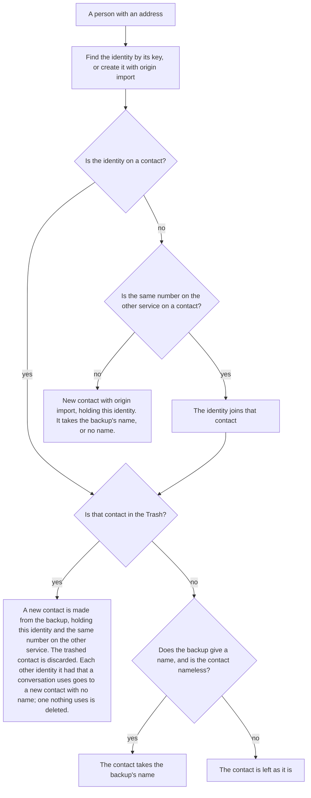

- A phone number has one key. A number with `+` keeps its country. A number
  without `+` is read in the country the Import Run states for the phone, and
  keeps its digits as written when the run states none: it is never read as
  a US number by default (#1676).
- iMessage, SMS, MMS and RCS are all text messages, so one number is one
  identity with the service `text_message`. The same number on WhatsApp is a second
  identity with the service `whatsapp`.
- An import names a contact only when the contact has no name, whatever made
  it: an earlier import, an address book load, or the person. A name a person
  typed, or a name a load set, survives every later import.
- A phone number the import cannot key with confidence is stored and flagged
  for review. It does not stop the import.

### A person the backup names with no address

A participant or a sender the backup names with no address gets an identity
of type `other` whose value is the name, on the conversation's service. From
there it is a person with an address, above: the identity finds its contact,
or a new contact takes the name. Nothing is looked up by name.

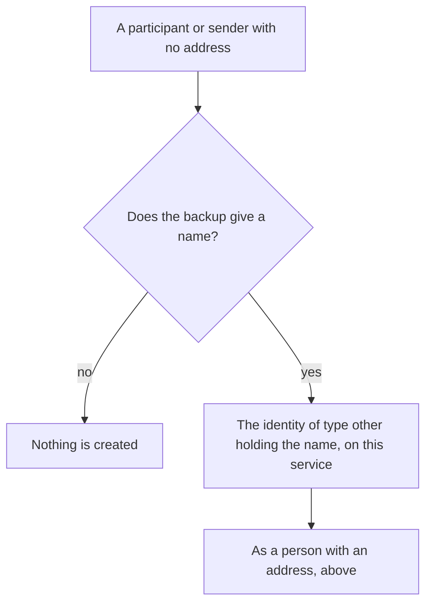

- Two people one service names alike, with no address for either, share the
  identity, and so the contact.
- The name on WhatsApp and the name in text messages are two identities, one
  on each service, and join one contact as the same number does.
- A contact whose only identities are of type `other` is Unknown, whatever
  its name.
- Each identity of type `other` is a person the exporter could not tie to an
  address, so the import is incomplete. The run counts the ones it met
  (`other_identities`).

### What gets no contact

A group conversation's own id, such as `chat1000000005`, is stored on the
conversation so the group is recognized next time. It is nobody's identity
and gets no contact. The same holds for the `orphaned:` key of a
conversation of orphaned messages; the person in it is its participant, and
gets a contact as one.

### When the run finishes

The Import Run makes one Contact Group named `<source> import <date>`. It
holds every contact the run created, named, gave an identity, or replaced
from the Trash. The membership is a snapshot and does not change later.

## An address book load

The code is `plan` and `apply` in
`crates/server/server/src/db/address_book.rs`.

The file has one row per identity and five columns: `contact_id`,
`display_name`, `service`, `identity`, `groups`. `service` is `Text Message`,
`Email` or `WhatsApp`, and no column states a type. A load runs
in Append mode, the default, or in Edit mode.

A vCard file becomes such a file through `from_vcard` in the same module,
which writes one row per number and email address on each card under
`card1`, `card2`, … and loads nothing.

### A cell a spreadsheet would run

A spreadsheet reads a cell that starts with `=`, `+`, `-`, `@`, a tab or a
carriage return as a formula, and runs it.
A name can come from a backup, and on WhatsApp the other person chooses their
own, so Export writes a `'` before every such cell, in every column.
A contact named `=HYPERLINK(…)` is written `'=HYPERLINK(…)`, and a phone
number `+6555550100` is written `'+6555550100`.
CSV quoting does not prevent this, because a spreadsheet removes the quotes
and then reads the cell as typed.
The code is `written_cell` and `read_cell` in `message-crate-csv`
(`crates/libs/csv/src/lib.rs`). Every CSV file Message Crate writes goes
through them.

The load takes off one `'` that comes before one of those characters, in any
column.
A spreadsheet can keep that `'` when it saves the file or drop it, and both
load the same, so a file loaded straight back changes nothing.
A cell that already starts with `'` and then one of those characters, such
as the name `'=1+1`, is written with one more `'` so that it loads back as it
was.
A `'` before any other text is part of the cell.

### 1. The whole load

Every row is checked before anything is written. Every broken rule is
collected, so one refusal names every bad row. The writes are one
transaction. A row with every cell blank is skipped.

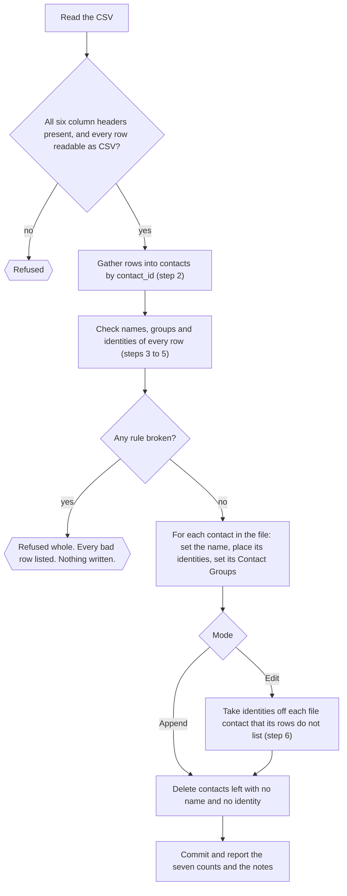

### 2. Which contact a row speaks for

A `contact_id` is known only when it is a whole number and is the id of a
contact in Contacts. The id of a contact in the Trash is not known. It is
treated like any other text and makes a new contact.

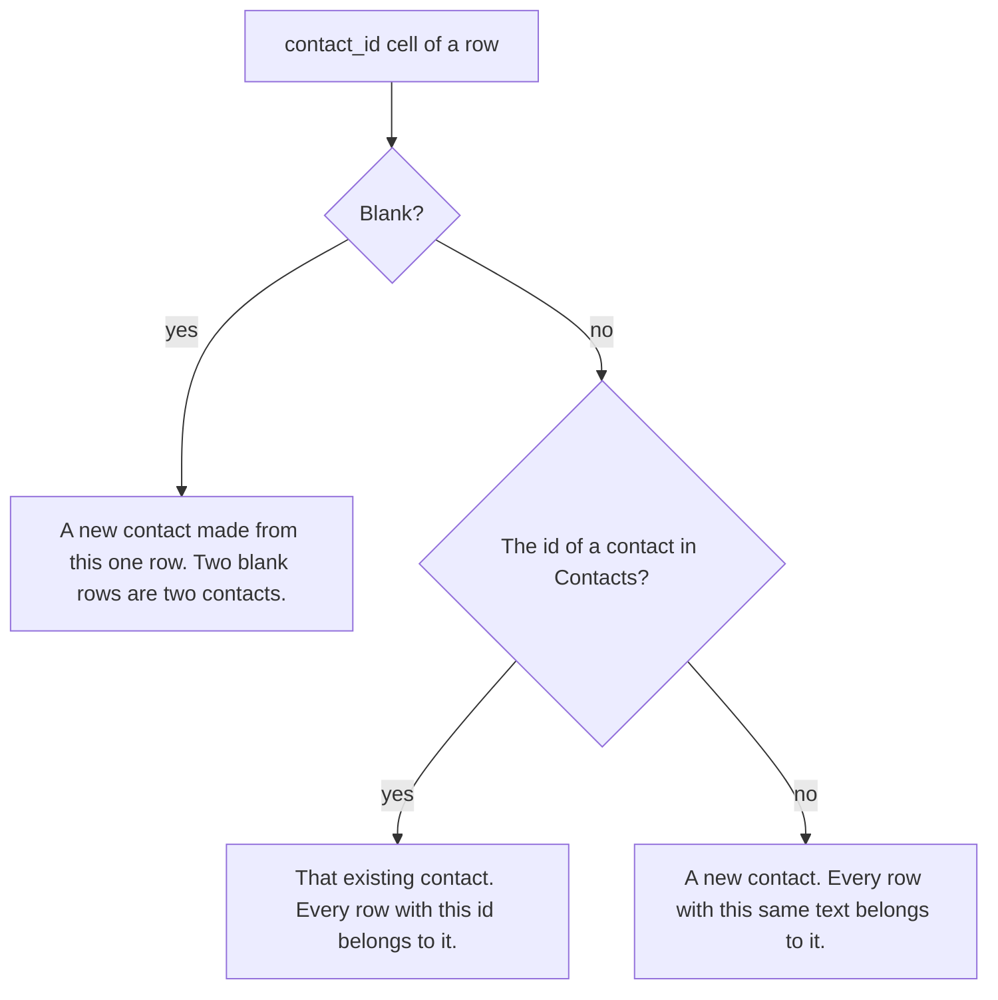

### 3. The name

The rows of one contact must give the same `display_name` or leave it blank.
A loaded name replaces the name of an existing contact whenever it differs,
whatever set the old name: an import, an earlier load, or a person typing.
A load applies exactly what the file says and never second-guesses it, so a
typed name has no protection from a different name in the file
([CONTACT-31](rules/contacts-identities-and-messages.md#contact-31-a-load-applies-exactly-what-the-file-says-and-never-second-guesses-it)).
An exported file carries the typed name, so a load straight back renames
nobody.
A rename by a load does not change the contact's `origin`. A contact a load
creates has the origin `address_book`.

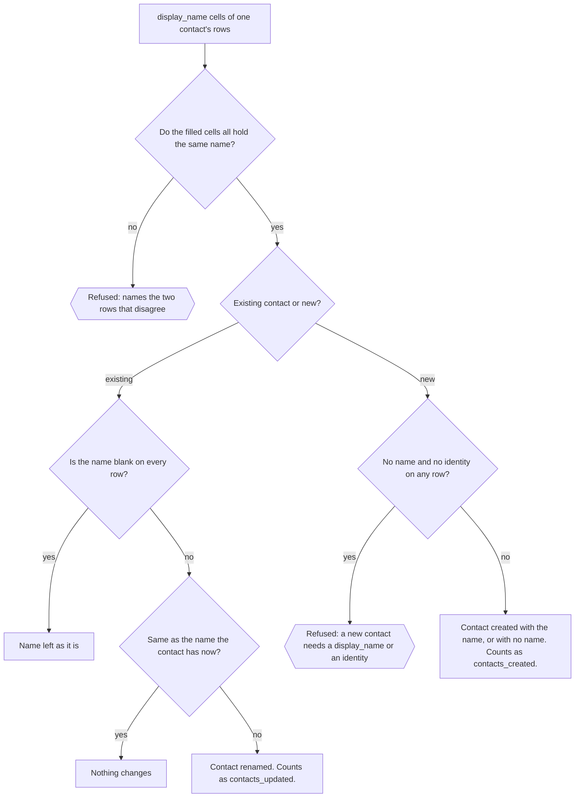

A contact name is stored without the whitespace at its start and end, on
every path that writes one: an import, a load, and a person typing.
Whitespace here is every character Unicode marks as White_Space, which is
what Rust's `str::trim` removes: spaces, tabs, line breaks and no-break
spaces among them.
So the name cell `'` then a tab then `Tab` creates a contact named `Tab`, and
a file loaded straight back renames nobody, because the name it compares
against was trimmed the same way.
A query reads and compares a stored name as it is, without trimming it again.
The code is `create_contact` and `propose_name` in
`crates/server/server/src/db/contacts.rs`.

### 4. Each identity: is the row valid?

A row that leaves `service` and `identity` both blank lists no
identity. That is how a contact with no identity is written.

`service` names the service: `Text Message` and `Email` are the
`text_message` service, and `WhatsApp` is `whatsapp`.
An identity written exactly as Message Crate already keys it on that service
is accepted as it stands, with the type it was stored with, so an exported
file always loads back.
Any other is typed by its shape among the types the service carries: a
number is `phone`, an `@` address is `email`, and anything else is `other`.
`Email` takes an email address only. On `WhatsApp`, one of WhatsApp's own
ids (`…@lid`, `…@g.us`, `…@broadcast`, `…@newsletter`) is `other`, as an import stores it, and any other `@` address
is refused, because WhatsApp carries no email address.

A phone number written without `+` that matches no key as written may be one
whose `+` a spreadsheet dropped.
Export writes `'+6555550100`, and a spreadsheet that drops the `'` can save
that cell as the number `6555550100`.
So the load first asks whether the contact the row names already holds `+`
followed by the value's digits.
If it does, the row names that identity.
Only the row's own contact is looked at, so a dropped `+` never attaches
another person's number to this contact.
A contact that holds both readings, such as `+6555550100` and
`6555550100`, refuses the load, naming both keys, because the row cannot
say which it means.
Otherwise the value is keyed by the phone rule, which keeps the digits as
written: a load states no country, so `555-555-0100` is the identity
`5555550100`, not `+15555550100` (#1676).

A person editing in a spreadsheet does not see the `+` go, so the load says
what it did.
Its `notes` name each row it read with the `+` back, and each value without
`+` that became a new identity.

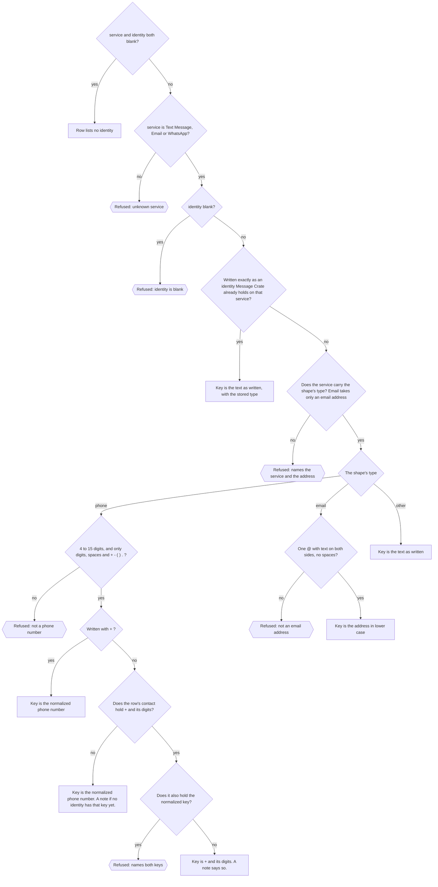

### 5. Each identity: who gets it?

An identity belongs to one contact. It moves to the file's contact freely
when its current holder has no name, or when the holder is also in the file.
Taking an identity from a named contact the file does not mention refuses
the load.
The refusal names the row, the identity, and both contacts, and says how to
let the identity move.

Can the holder be added to the file?

Only when it is in Contacts.
A holder in the Trash can't be, because its id reads as unknown text and
makes a new contact (step 2).
For a holder in the Trash, the refusal says so, and says to restore it and
add it to the file, or to delete it for good first.

A load takes only the identity the row lists. The same number on the other
service stays where it is, with the contact that holds it, unless a row
lists it too, and a file that lists the two under different contacts puts
each where its row says. A load applies exactly what the file says and
never second-guesses it, so an import's rule that one number is one person on
every service does not apply here ([CONTACT-15](rules/contacts-identities-and-messages.md#contact-15-one-number-is-one-person-on-every-service)).

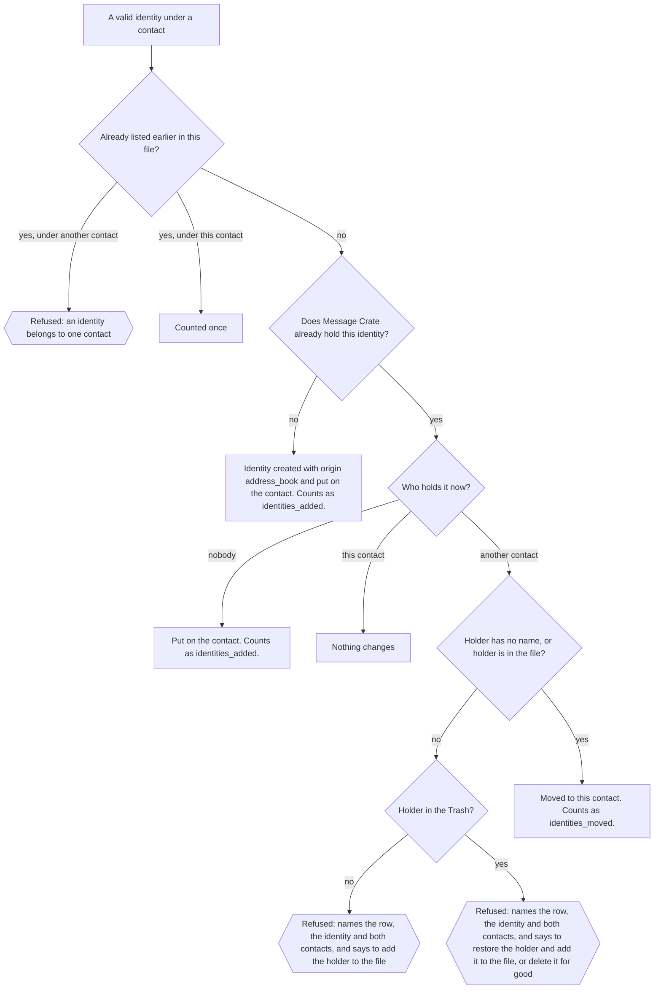

### 6. Contact Groups, and what Edit removes

The rows of one contact must list the same Contact Groups, in any order and
any letter case, or leave the cell blank. Names are separated by `;`. A name
Message Crate would not let a person create refuses the load. A name that
matches no Contact Group, ignoring letter case, creates one.

A Contact Group's name can't hold `;`, because the `groups` cell separates
names with it. Creating or renaming a Contact Group to such a name is
refused. The cell is therefore never escaped: the address book is meant to be
edited by hand in a spreadsheet, and an escape such as `\;` would be a trap
there. An export loaded straight back lists the same Contact Groups.
Message Tags are not in the address book and may hold `;`.

Append only adds. Edit makes each contact in the file hold exactly the
identities and memberships its rows list, so a row for a number's
text-message identity does not keep its WhatsApp identity on the contact:
with no row of its own, that one comes off too. In Edit, a contact whose `groups`
cell is blank on every row loses all its memberships.

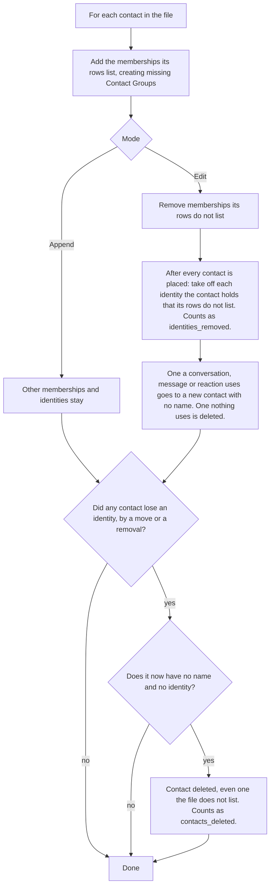

### What a load leaves alone

- A contact the file does not list, in both modes. The one exception is a
  nameless contact that gives up an identity to a file contact. It is
  deleted if that leaves it empty.
- Identities and memberships of a file contact that its rows do not list, in
  Append mode.
- Contacts in the Trash. The file cannot speak for one. A nameless one can
  still give up an identity.

### The seven counts

| Count | What it counts |
|---|---|
| `contacts_created` | Contacts the load created |
| `contacts_updated` | Contacts in the file that were renamed, or whose identities or memberships changed |
| `contacts_deleted` | Contacts left with neither a name nor an identity |
| `identities_added` | Identities put on a contact that no contact held before |
| `identities_moved` | Identities taken from one contact and given to another |
| `identities_removed` | Identities taken off a contact. Edit only |
| `groups_created` | Contact Groups the load created |

Beside the counts, `notes` holds one sentence for each phone number written
without `+` that the load read with its `+` back, or that became a new
identity (step 4). Each sentence starts with its row number.

## The two side by side

| | Import of a backup | Address book load |
|---|---|---|
| What starts it | Each person the backup's messages meet: a participant, the other side of a one-to-one conversation, or a sender | Each row of the CSV |
| New contact | One for every address no contact holds, named if the backup gives a name, otherwise nameless | One for a blank or unrecognized `contact_id`. It needs a name or an identity |
| Naming an existing contact | Only when the contact has no name, whatever made it | Whenever the file's name differs, whatever set the old one |
| Same number on the other service | Joins the contact that already holds the other one | Stays where it is. Only a row for it moves it, so a file can split a number |
| Identity already on another contact | Never moved. The import uses that contact | Moved if the holder is nameless or in the file. Otherwise the load is refused |
| Removing things | Never removes an identity, a membership, or a contact outside the Trash | Edit removes unlisted identities and memberships. An emptied nameless contact is deleted |
| Contact in the Trash | Discarded and made new from the backup. Its other identities in conversations go to new contacts with no name | Cannot be addressed. Its id is treated as unknown text |
| Person named with no address | An identity of type `other` holding the name, on the conversation's service, and its contact | A row with a name and blank identity columns makes a contact with no identity, and never matches by name |
| Contact Groups | One group per Import Run, holding the contacts the run touched | The groups the `groups` column lists |
| Bad data | No refusal for contact reasons. An odd phone number is stored and flagged | Any broken rule refuses the whole file |
| `origin` written | `import` | `address_book` |

## What follows from the differences

- **A typed or loaded name survives every later import.** An import cannot
  rename a contact that has a name.
- **A nameless contact is an import's to name, whatever made it.** A contact
  a load made from a row with an identity and a blank name is named by the
  first later import that knows the number.
- **A load can rename anything.** It replaces a typed name as readily as an
  imported one.
- **Edit treats a blank `groups` cell as "no groups".** It does not mean
  "leave the memberships alone".
- **A load can split one number across two contacts.** It moves only the
  identities its rows list, so a row for a number on one service leaves the
  number on the other service where it is. An import never splits one.
- **A contact the file does not list can still be deleted.** A nameless
  contact that gives up its last identity to a file contact is removed.

## New Contact

The code is `create_contact` in
`crates/server/server/src/contacts_api/create.rs`, behind
`POST /v1/contacts` with a JSON body. The same route takes a `text/csv` body
as an address book load, and the body's `Content-Type` says which.

New Contact adds one contact with a name and zero or more identities. It
never moves an identity. Each identity is typed by its service and its
shape, as an identity added in the contact drawer is, and is then found or
created. One that another contact holds, named or nameless, in the Trash or
not, or one of the account's own identities, refuses the request, and
nothing is created
([CONTACT-58](rules/contacts-identities-and-messages.md#contact-58-new-contact-refuses-an-identity-another-contact-holds-and-offers-no-merge)).
Every identity is checked before the contact is written, so one refusal
names every identity held elsewhere, each with the contact that holds it.

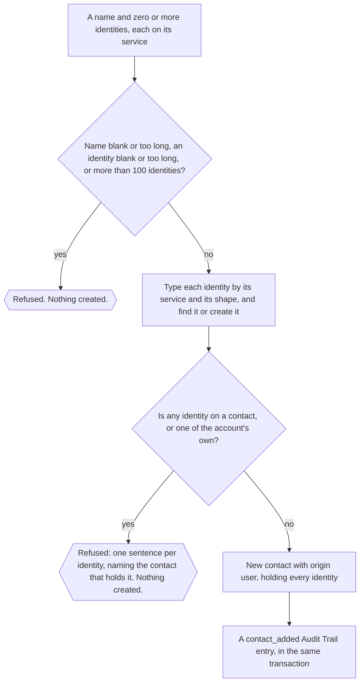

The checks and the writes are one write transaction, so a refusal also
rolls back the identity rows the checks created, and no other request can
put an identity on a contact between its check and the link. A contact with
a name and no identity is Unknown, because nothing reaches it yet. Undo on
the Contacts list moves the new contact to the Trash, and Redo restores it.

## Merge Contacts and its Undo

The code is `merge` and `unmerge` in
`crates/server/server/src/db/contact_merges.rs`, behind
`POST /v1/contacts/{id}/merge` and `POST /v1/contacts/{id}/unmerge` in
`crates/server/server/src/contacts_api/merge.rs`. The rules are
[CONTACT-57](rules/contacts-identities-and-messages.md#contact-57-a-contact-merge-can-be-undone-until-the-next-merge).

### A merge

Merge Contacts makes two to ten contacts one. The contact in the path is the
target, the one that owns the name the person picked, and the contacts in
`from` go into it. The target keeps its id, name and origin.

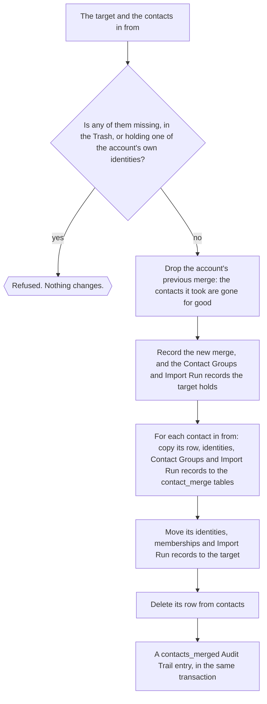

- Each identity moves to the target as it is, with its origin. No identity
  is joined to another, so no conversation, participant, message, reaction
  or content key changes, and no duplicate pass runs.
- A Contact Group both contacts were in stays one membership.
- An Import Run with a record of both contacts keeps the more consequential
  reason on the target.
- The merged contact's row is deleted, not marked, so it is in no list,
  search or export, and its page answers `404 Not Found`.

### Why the next merge makes the previous one permanent

An account keeps one merge record, its most recent. The `contact_merge_*`
tables hold the merged contacts' rows as they were, so that an undo can
write them back. Each new merge first deletes the previous record, and with
it the only copy of the contacts that merge took. By then those contacts
hold nothing but their names, because their identities, memberships and
Import Run records are on the target. A person merges and checks the result
in one sitting, so one merge that can be undone is enough, and the server
does not keep every merged contact for good.

So a merge can delete contacts for good without going through the Trash,
and it needs the `delete` permission. The Demo Account is refused every
merge.

### The Undo

The undo writes each merged contact back under its own id. It can, because
`contacts.id` is `AUTOINCREMENT`: a merged contact's id is never given to
another contact.

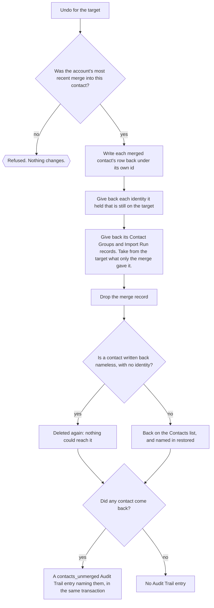

- An identity the person moved off the target since the merge stays where
  it is, and the merged contact comes back without it.
- The target keeps what was its own before the merge.
- The answer names the contacts written back, in `restored`, so the toast
  says which came back and Redo merges only those.

Undo Merge Contacts is on the Contacts list's menu, with the toast's Undo
and Ctrl+Z (Cmd+Z on a Mac), in the browser session that made the merge.
The contact page offers no unmerge.

## Delete Contacts

Delete Contacts on the Contacts list moves the checked contacts to the Trash
in one request, `PATCH /v1/trash/contacts`, with their ids in `add`. Its
Undo sends the same ids in `remove`. The code is `update_trashed_contacts`
in `crates/server/server/src/db/trash.rs`. A contact the account no longer
holds is skipped, a contact already in the Trash stays there, and one list
holds at most 10000 ids, so the web app sends a larger selection in parts of
that size.

Moving a contact to the Trash changes none of its identities. An import that
meets one of them makes a new contact and discards the trashed one
([CONTACT-54](rules/contacts-identities-and-messages.md#contact-54-an-import-replaces-a-trashed-contact)),
as the first diagram on this page shows. Deleting a contact for good, from
the Trash, removes its name and its Contact Group memberships and keeps its
identities and conversations
([CONTACT-45](rules/contacts-identities-and-messages.md#contact-45-deleting-a-contact-keeps-its-conversations)).

## What the Audit Trail records

The Audit Trail records each change on this page that adds, removes or
replaces contacts, one entry per action the person took, with a count and
contact ids and never a name
([CONTACT-59](rules/contacts-identities-and-messages.md#contact-59-the-audit-trail-records-what-adds-removes-or-replaces-contacts-and-no-edit)).
The route that makes the change writes the entry in the change's own
transaction, so the two land together or not at all. The one exception
today is an address book load, which writes its entry after the load's own
transaction commits (#3310). Every entry in the table below goes through
`record_contact_change` in `crates/server/server/src/db/audit_trail.rs`,
except `address_book_loaded` and `trash_emptied`, which go through
`record_about` in the same file.

| Entry | Written by | Holds |
|---|---|---|
| `address_book_loaded` | An address book load | The mode, and the counts of contacts made, changed and removed |
| `contact_added` | New Contact | The new contact |
| `contacts_trashed` | Delete Contacts, and the Undo of New Contact | The contacts moved to the Trash |
| `contacts_restored` | The Undo of Delete Contacts, and the Redo of New Contact | The contacts taken out of the Trash |
| `contact_deleted` | Deleting a contact for good, from the Trash | The contact |
| `trash_emptied` | Empty Trash | The counts of conversations and contacts |
| `contacts_merged` | Merge Contacts | The target, and the contacts merged into it |
| `contacts_unmerged` | The Undo of Merge Contacts, when a contact comes back | The target, and the contacts written back |

Moving a contact to the Trash that is already there, or an undo of a merge
that brings no contact back, changes no contact and writes no entry. Empty
Trash and an address book load write theirs even when they change nothing:
an empty Trash gives `trash_emptied` counts of 0, and a file that matches
the contacts row for row gives `address_book_loaded` counts of 0 (#3311).
Undo and Redo write no entry of their own, so each is recorded as the
same change made by hand. An import of a backup is recorded as its Import
Run, with no contact entry, and an edit in the contact drawer or a Contact
Group change writes no entry.
