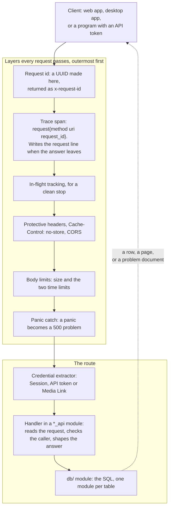
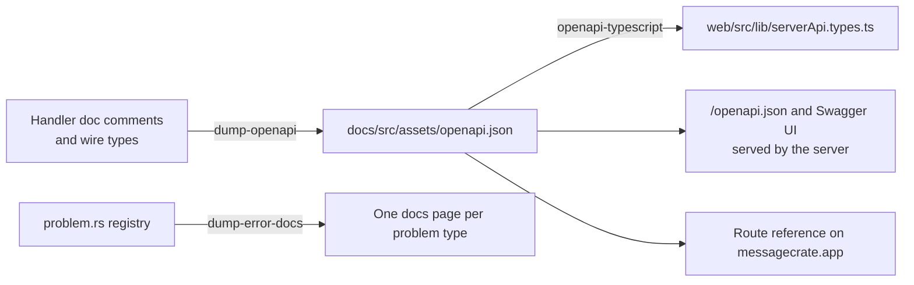

# The HTTP interface

Everything a client does with a Message Crate goes through one HTTP
interface under `/v1`: the web app, the desktop app's Import and Export, and
any program holding an API token. This page follows one request through the
server and shows the shapes every route shares, so a reader can predict what
a route they have not seen will look like. The constraints a change must keep
are in [The HTTP interface: rules](rules/http-api.md).

The interface is described by a generated OpenAPI document that the server
serves at `/openapi.json` and that is checked into the repository as
`docs/src/assets/openapi.json`. Its paths and operations are counted there,
not here.

## A request's path



Reading top to bottom:

1. **The request id.** The outermost layer makes a UUID for the request and
   puts it in the `x-request-id` header of whatever answer leaves. A client's
   own id is ignored. The id is also in every problem document and on every
   log line the request writes, so a person who sees a failure on a screen
   can quote it and find the request in the server's log.
2. **The trace span.** The request runs under a `request` span carrying its
   method, its URI with sensitive query values already hidden, and the id.
   When the answer leaves, this layer writes one line with the status and
   latency, at `INFO` for every answer but a successful routine one, such
   as a health probe, which is `DEBUG`. [The server's log](server-log.md)
   follows that line.
3. **In-flight tracking.** Every request is counted until its answer's body
   is sent, so a server told to stop can wait for the ones still running,
   up to 30 seconds, and name any it had to cut off.
4. **Headers and CORS.** Three protective headers go on every answer, and
   `Cache-Control: no-store` on every `/v1` answer that did not set its own,
   so nothing in a browser or a proxy keeps message text or a token. The
   CORS layer sits outside the body limits, so a browser can read even a
   refusal they answer.
5. **Body limits.** A JSON body is held to a fixed cap, and every body to
   the two time limits: a body that sends nothing for 60 seconds or is still
   arriving after 300 is answered `408 Request Timeout`. Attachment and
   import-batch uploads start their own clocks because they first wait for
   a slot.
6. **The panic catch.** A handler that panics answers the same
   `500 Internal Server Error` problem document as any other internal
   failure, with its request id, and every layer outside treats it as a
   normal answer.
7. **The credential extractor.** Each handler names the credential it takes
   as an argument type. The extractor reads the `Authorization` header, or
   the `media_link` query parameter on the three asset reads, looks the
   credential up, and refuses the request before the handler runs: `401
   Unauthorized` for a credential that fails, `403 Forbidden` for one that
   is valid but not allowed.
8. **The handler.** It reads the request, checks what the caller may do
   with the row it names, calls into `db/` and shapes the answer. It holds
   no SQL. Its signature names the parts of the server state it reads, so a
   reader sees its dependencies without reading its body.
9. **The database module.** Every query lives in `db/`, in the module for
   the table it is chiefly about, written for SQLite. A `db/` function
   returns a plain or typed error and never an HTTP one. The handler layer
   turns an outcome into a status.

## Three shapes every route shares

**An address is an integer id.** `/v1/contacts/{id}`, `/v1/accounts/{id}`,
and under a member its collections, `/v1/accounts/{id}/api-tokens/{id}`. A
collection is plural. A singular path is a singleton such as `/v1/server` or
`/v1/session`. An asset is the one resource addressed by content: the
SHA-256 of its bytes, because the file exists before any row does. A verb
appears only as a sub-resource of a member for an action that is not a field
write: `POST /v1/imports/{id}/complete`, `POST /v1/conversations/{id}/trash`.

**A list is a page.** Every list answers the same four keys:

```json
{"items": [...], "total": 4213, "limit": 40, "offset": 80}
```

`limit` is 1 to 500 and defaults to 40. Sorting is `sort=-field,field`.
Filtering is the search language in `q`, the same language a person types
into the Contacts, Conversations and Messages lists, and nothing else. A
query parameter the route does not declare is refused, so a typo never
silently returns the unfiltered list. Two lists bend the shape for a reason
they state: the Messages list adds a `search` key that says how the server
read the query, and the server's log lines page from a line id because they
are written while they are read.

**A failure is a problem document.** Every failure, from any layer or
handler, is an RFC 7807 body served as `application/problem+json`:

```json
{
  "type": "https://messagecrate.app/docs/developer/reference/errors/validation-failed",
  "title": "Validation failed",
  "status": 422,
  "errors": ["sort: unknown key 'year'; accepted keys are date, name"],
  "request_id": "3f2a9c6e-7b1d-4e58-9a0f-2c4d8b1e6f70"
}
```

Each `type` is a page on the docs site, one per problem type, with one
exception: a `500 Internal Server Error` carries `about:blank`, because no
page could say anything a reader could act on. The registry is `problem.rs`,
and the pages are generated from it, so they cannot drift. A client reads
`type` to tell one failure from another. The sentence in `detail`, or each
entry of `errors`, reads like `asset not found`: lowercase, no final period,
naming the thing and what is wrong with it, so a screen can show it alone or
join it with others. The form is a rule, with its reason, under "Failures"
in the rules document.

## What a status code means

| Answer | When |
|---|---|
| `200 OK` | A read, or a write that completed and has something to return, even when it changed nothing |
| `201 Created` | A resource was made, and `Location` names it |
| `202 Accepted` | The write finishes after the answer. Only the Demo Account rebuild answers it |
| `204 No Content` | A write with nothing to return |
| `206 Partial Content` | One byte range of an asset, Preview or Thumbnail, for a player that streams |
| `400 Bad Request` | The body could not be read at all: not JSON, or the connection broke |
| `401 Unauthorized` | The credential failed, or the login was refused |
| `403 Forbidden` | The credential is valid but may not do this |
| `404 Not Found` | The row is not there, or the caller does not hold it |
| `405 Method Not Allowed` | The path exists and the method does not |
| `406 Not Acceptable` | An `Accept` header that names nothing JSON, on a route that answers JSON |
| `408 Request Timeout` | The body stalled or took too long |
| `409 Conflict` | A name collision, a wrong state, or a merge the client must confirm |
| `413 Payload Too Large` | A body over its cap |
| `415 Unsupported Media Type` | No or a wrong `Content-Type` on a body |
| `416 Range Not Satisfiable` | A `Range` that selects no byte of the file |
| `422 Unprocessable Entity` | The request was read and broke a rule. A validation failure lists every rule it broke in `errors` |
| `500 Internal Server Error` | A bug. The request id finds its `ERROR` line in the log |
| `503 Service Unavailable` | The database was busy, which carries `Retry-After`, or the server is stopping, which does not. Either way the same request succeeds later |

## Who may call what

Three credentials exist, and the OpenAPI document declares each as a
security scheme, so every operation says which it accepts.

| Credential | Made by | Reaches |
|---|---|---|
| **Session** | `POST /v1/session` with a username and password | Everything the account may do: browse, import, export, delete, as its permissions allow. The owner's Session reaches accounts, server settings and the log, and no messages. |
| **API token** | The account, with `import` or `export` scopes capped by its own | The Import and Export pipelines, and asset reads under `export`. Never browsing, never deletion, never the owner. |
| **Media Link** | `POST /v1/assets/{sha256}/media-links` from a Session | One asset, its Preview and Thumbnail, for an hour or until its Session ends, without a header, so a media element can stream it. |

The credential names the account. No route takes an account parameter. The
owner holds no messages ([ADR 0008](../adr/0008-the-owner-holds-no-messages.md)),
so routes split along that line: `/v1/accounts/{id}/...` is what the owner
and the account both read, such as an account's import history as a record
of runs, while `/v1/imports` and `/v1/exports` are the pipelines themselves,
which need the permission the owner's Session never carries.

## Runs

An import and an export are each a **run**: a resource created once with
its settings, fed by batches or read in pages, and closed by the client
with `complete`, `discard` or `cancel`. A run is recorded for good, outlives
its account, and says who started it. An Export Run is a snapshot: the
server lists the matching message ids when the run is created, and pages
walk that list, so an import or a deletion in between cannot shift them.

## The reference and the generated types



The handlers are the source. Each operation's summary is the first sentence
of its handler's doc comment, its error responses are assembled from the
credential it takes and the body it reads, and every field's description is
its Rust doc comment. A test fails when the checked-in document differs from
what the server emits, and another when the web app's generated types differ
from the document. Wire types that a client crate also reads live in the
`api-types` crate, so the server and the Export code share one definition
and a rename stops compiling rather than failing at run time.

## Where it lives

| Piece | Code |
|---|---|
| The router and the layer order | `with_server_layers` and `http_app` in `crates/server/server/src/server.rs` |
| Request id, body limits, headers, panic catch | `crates/server/server/src/request_id.rs`, `middleware.rs`, `limits.rs` |
| In-flight tracking for a clean stop | `crates/server/server/src/in_flight.rs` |
| Connection limits | `crates/server/server/src/connections.rs` |
| Credential extractors | `crates/server/server/src/auth.rs`, `credentials.rs` |
| Route groups, one module per first path segment | `crates/server/server/src/*_api.rs` and their directories; Contact Groups and Message Tags share `named_set_api.rs` |
| Pages and sorting | `crates/server/server/src/paging.rs`, `declared_query.rs` |
| Problem types and the error mapping | `crates/server/server/src/problem.rs`, `api_error.rs` |
| The SQL | `crates/server/server/src/db/` |
| Shared wire types | `crates/libs/api-types/` |
| The OpenAPI document and its rules | `crates/server/server/src/openapi.rs`, `openapi/` |
| The generated problem-type pages | `crates/server/server/src/error_docs.rs` |
| The web app's client | `web/src/lib/api.ts`, `serverApi.ts`, `serverApi.types.ts` |
| The desktop app's client | `crates/libs/http/`, `crates/libs/import/`, `crates/libs/export/` |
