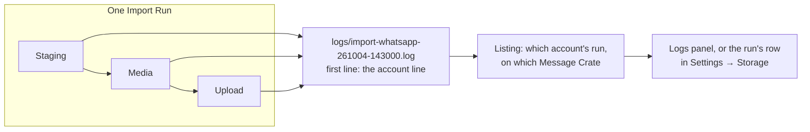

# Import Run logs

The desktop app keeps a log of each Import Run it runs, and one of its own
work outside any run. Both stay on the computer that wrote them and are read
in the desktop app's Logs panel with the same viewer that reads the server's
log. This page follows a run's log from its first line to the screen. The
constraints a change must keep are in
[Import Run logs: rules](rules/import-run-logs.md). The server's own log is a
separate thing: [The server's log](server-log.md).

## Three logs, one viewer

| Log | Written by | Where it is | Who reads it, and where |
|---|---|---|---|
| The server's log | `serve` | The Data Directory of the server | The owner, in Owner Home → **Logs**, from a browser or the desktop app |
| An Import Run's log | The desktop app, during the run | The Logs Directory of the computer that ran the import | The owner, in Owner Home → **Logs**; the account that ran it, from the run's row in Settings → Storage; both in the desktop app on that computer |
| The desktop app's log | The desktop app, outside any run | The Logs Directory of the computer the app runs on | The owner, in Owner Home → **Logs**, listed as **Desktop app** |

A browser reads the server's log only. A run log never leaves the computer
that ran the import.

## A run's log



Reading left to right:

1. **The first line names the run and its account.** Once the server has
   created the run and before Staging writes anything, the desktop app
   writes one `INFO` line with the run's id, the account's id, the server's
   address and the Message Crate's id:

   ```text
   2026-10-04T14:30:00.123456Z  INFO Import Run 42 by account 7 on http://127.0.0.1:8080, Message Crate 3f2a9c…
   ```

2. **Every stage writes into the same file.** Staging, Media and Upload each
   add their lines to one log per run in the Logs Directory, named for the
   run's directory in the Staging Directory. A resumed run writes on into the
   same log. The run's directory is deleted when the run ends, and its
   log is kept ([RUNLOG-2](rules/import-run-logs.md#runlog-2-kept-on-this-computer-never-deleted)).
3. **The listing reads the account line to decide who sees the log.** The
   owner sees every log on the computer, and an account sees the logs of
   its own runs on the Message Crate it is signed in to
   ([RUNLOG-3](rules/import-run-logs.md#runlog-3-the-account-line)).
4. **The same line ties a run's directory to its run.** When an account opens
   Import, the desktop app finds that account's run directories through
   their logs, asks the server which of those runs are closed, and deletes
   their directories
   ([RUNLOG-3](rules/import-run-logs.md#runlog-3-the-account-line)).
5. **The viewer reads it newest first.** The Logs panel and the run's row in
   Settings → Storage read the log the way the server's log is read, with the
   same code: the newest lines first, walking back a chunk at a time,
   filtered by level and text. A line's id is its byte offset in the file,
   which never moves because the log is only ever appended to. Each file
   downloads byte for byte.

## The desktop app's own log

What the app does and fails at outside an Import Run goes to
`desktop-app.log` in the Logs Directory: an event no window received, a
program in the Tools Directory whose record could not be written, a server
whose processes will not end with it, and the warnings the Apple Messages
Reader writes during the Import screen's identity check. Each line is at
`WARN`, because each is something the app went on without. The file is made
when its first line is written, so an app with nothing to say has none. It
names no account, so the listing gives it to the owner alone.

## What a line looks like

Each line starts with its time in UTC to the microsecond and its level,
`ERROR`, `WARN` or `INFO`, then the text, in the format of the server's log
defined once in `crates/libs/log-lines`. Text with a line break, such as the
Upload's summary, becomes one line per part, each with its own time and
level, and every other control character is escaped.

| Level | What is written there |
|---|---|
| `ERROR` | What stopped: a stage that failed, a conversation not sent, an Import Errors row of kind `error` |
| `WARN` | What the run went on without: an attachment not uploaded, a skipped row, a digest that did not match, a session the server stopped accepting, and the whole output of a failed `wtsexporter` run |
| `INFO` | What the run did |

A run log never holds a password, a token, message text or attachment bytes.
Unlike a line of the server's log, it does name the conversation files and
attachments the run read, such as `+15555550101.jsonl`, because that is what
explains a failure, and the owner reads those names with the rest of the
log.

## A filter, not a guard

The listing decides what each screen offers, not who can open a file: a run
log is a plain file in the Logs Directory, readable by any program the
computer's user runs and by no other user of the computer
([RUNLOG-7](rules/import-run-logs.md#runlog-7-a-filter-not-a-guard)).

## Where it lives

| Piece | Code |
|---|---|
| The line format, shared with the server's log | `crates/libs/log-lines` |
| A run log's lines, levels and the account line | `crates/core/message-crate-core/src/run_log.rs` |
| Naming and opening a run's log in the Logs Directory | `src-tauri/src/app_directories.rs` |
| The desktop app's own log | `src-tauri/src/app_log.rs` |
| Listing and reading both, for the Logs panel and Settings → Storage | `src-tauri/src/run_logs.rs` |
| The viewer, one for every log | `web/src/components/logs/LogViewer.tsx`, `logSource.ts` |
| Finding a closed run's directory through its log's account line, and deleting it | `src-tauri/src/run_directories.rs`, `delete_closed_run_dir` in `src-tauri/src/commands/staging.rs`, `web/src/screens/import/closedRunDirectories.ts` |
