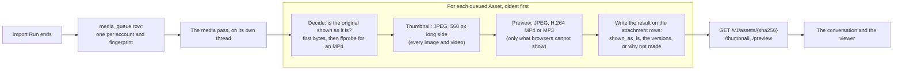
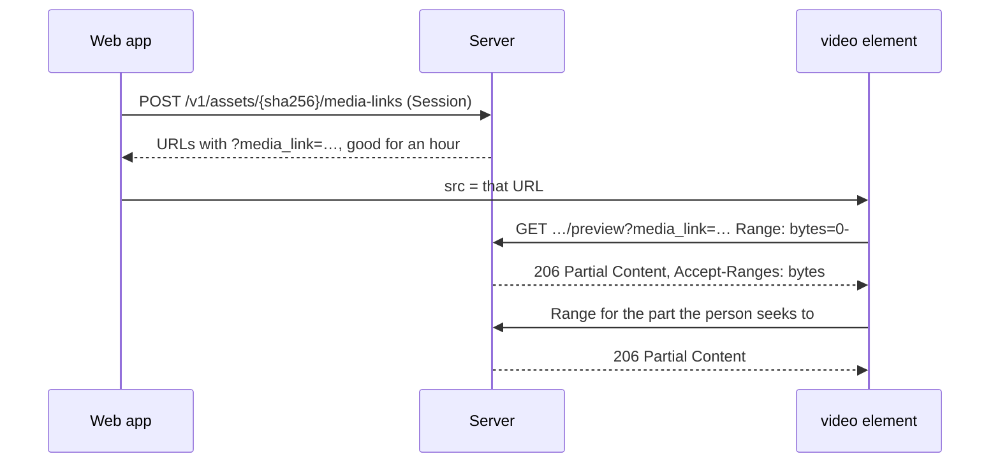

# Media

An attachment arrives as whatever the phone held: a HEIC photo, an HEVC
video, an AMR voice note, or a plain JPEG. Message Crate keeps that original
untouched and makes a small Thumbnail of each photo and video and, where
needed, a copy every browser can show, so a conversation scrolls fast and a
photo opens in any browser. This page follows an attachment from the import
that brings it to the screen that shows it. The constraints a change must
keep are in [Media: rules](rules/media.md).

The words Asset, Preview, Thumbnail and Media Link are defined in
`CONTEXT.md`.

## The life of an attachment

Reading left to right:

1. **The import ends.** An Import Run that completes or is discarded adds
   every Asset it wrote to the `media_queue` table and wakes the pass. The
   run does not wait: converting a video takes far longer than importing
   its message. The `import` command queues the same way, and the next
   `serve` works through what it left.
2. **The pass takes one Asset at a time, oldest first.** It runs on a
   thread of its own and holds no database connection while ffmpeg runs, so
   a long conversion never holds a request. Before each conversion it first
   decides every Asset queued since it last looked, so a photo queued behind
   a long video opens at once.
3. **Decide whether the original is shown as it is.** Every browser shows a
   JPEG, PNG, GIF or WebP image, an MP3, and an MP4 with H.264 video, and
   nothing else. The type comes from the file's first bytes, not from what
   the import declared, and an MP4 is opened with ffprobe to read its codec.
   The answer is stored on the attachment rows as `shown_as_is`, so no read
   ever runs ffprobe.
4. **Make the Thumbnail.** Every image and video gets a JPEG at most 560
   pixels on its long side: the image scaled down, or a video's first frame.
   It is tens of kilobytes, which is what lets a conversation of thousands
   of photos scroll.
5. **Make the Preview, only where it is needed.** An original a browser
   cannot show gets a copy it can: a JPEG of an image, an MP4 with H.264
   video at most 1080p and AAC audio, or an MP3. An original every browser
   shows gets none, because it is already the best copy there is.
6. **Write the result.** Both versions are stored in the account's converted
   directory, each named by the SHA-256 of its own bytes, and the original's
   attachment rows name them. When a version could not be made, the rows
   record why, in ffmpeg's words or a fixed phrase of the server's, and
   which kind of failure it was. The queue row is removed either way.
   `process-assets` tries failed ones again by hand.
7. **The routes.** A client addresses every version by the original's
   fingerprint: `GET /v1/assets/{sha256}` for the original, and
   `/thumbnail` and `/preview` under it. An attachment says which exist in
   `thumbnail_mime_type` and `preview_mime_type`. All three answer HTTP
   range requests, so a video streams.
8. **The screen.** The conversation shows Thumbnails and fetches each only
   when its message scrolls near the screen. Opening an attachment loads
   the original when `shown_as_is` is true, the Preview when it is false and
   one exists, and otherwise says that no copy a browser can show exists yet
   and offers the download. Downloading always gives the original.

## The three versions

| Version | What it is | Who gets one | Where it lives |
|---|---|---|---|
| Original | The file as imported, never changed | Every attachment | The account's assets directory, by its SHA-256 |
| Thumbnail | A JPEG at most 560 pixels on its long side; a video's first frame | Every image and video, a GIF included | The converted directory, by its own SHA-256; named by the attachment rows |
| Preview | A JPEG, an H.264 MP4 at most 1080p with AAC audio, or an MP3 | Only an original browsers often cannot show; never a real GIF | The converted directory, by its own SHA-256; named by the attachment rows |

## How a video plays

A media element loads its own `src` and cannot send the Session's
`Authorization` header, so the web app asks the server for a Media Link, a
signed URL that reads one asset and its versions for an hour, and hands that
to the element. The element asks for the file a range at a time, plays on
the first range, and seeks by asking for another. Nothing is fetched whole
and handed over as a blob. The desktop app downloads an original the same
way, copying the server's answer to the chosen file as it arrives.

## When the pass cannot convert

Without ffmpeg the pass still decides `shown_as_is` for every type but MP4
and leaves the queue as it is, so the Assets wait for a server that has it.
Every server looks for ffmpeg and ffprobe on `PATH` first, then in the
Tools Directory it is given with `--tools-dir`, which is where the desktop
app downloads them to. The Docker image carries them. A server started by
hand with neither makes nothing.

An ffmpeg that hangs is stopped: a short step such as reading one frame
gets 15 seconds, a video conversion is stopped when its reported position
has not moved for two minutes or has run past twice the file's length, and
an audio conversion has a time limit scaled to its length. The reason is
recorded on the attachment rows, the viewer shows it in place of the
Preview, and the owner's read of the Import Run lists every file left
without a version and why. No single Asset and no single error stops the
pass.

## Where it lives

| Piece | Code |
|---|---|
| Deciding the type and whether a browser shows it | `crates/libs/media/src/signature.rs`, `versions.rs` (`browser_shows`) |
| Making a Thumbnail and a Preview | `crates/libs/media/src/versions.rs` |
| Running ffmpeg and ffprobe, stopping a hung one | `crates/libs/media/src/tools.rs`, `probe.rs` |
| The reason recorded when a version is not made | `crates/libs/media/src/process.rs` |
| The queue and the pass | `crates/server/server/src/media_queue.rs`, `process_assets.rs` |
| The attachment rows' versions and reasons | `crates/server/server/src/db/attachment_versions.rs`, `schema/sql/messages.sql` |
| The three asset routes and range answers | `crates/server/server/src/assets_api.rs`, `assets_api/ranges.rs`, `assets_api/media_links.rs` |
| Which version a screen opens | `web/src/lib/attachmentMedia.ts`, `assetUrl.ts` |
| Fetching near the screen, streaming on play | `web/src/hooks/useThumbnail.ts`, `useStreamedMedia.ts` |
| The viewer and the download | `web/src/components/AttachmentLightbox.tsx`, `web/src/lib/downloadAttachment.ts` |
