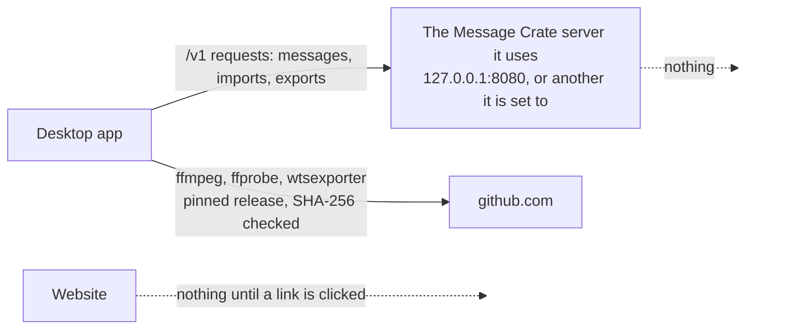

# Outbound connections

Message Crate holds a person's private message history, so the first thing a
person deciding to trust it asks is what it sends anywhere. The answer is
short: the desktop app talks to the Message Crate server it is set to use,
and downloads three programs from GitHub. Nothing else leaves the computer,
and the server and the website connect to nothing on their own. The
constraints a change must keep are in
[Outbound connections: rules](rules/outbound-connections.md), and the
published statement for people is on the user guide's page
[What Message Crate is](../src/content/docs/docs/user/try/what-is-message-crate.md),
under "What leaves the computer".

## Who connects to what

| From | To | What for |
|---|---|---|
| The desktop app, `import` and `export` | The server address they are given | Every request of the HTTP interface, and no other host |
| The desktop app | `https://github.com` | The Tools Directory: ffmpeg, ffprobe and wtsexporter, each pinned to one release and one SHA-256 |
| The server | Nothing | It answers requests and reads its own disk |
| The website | Nothing | Its links to messagecrate.app and GitHub open only when clicked |

## How the download works

At every start the desktop app checks its Tools Directory in the background
and downloads any of the three programs that is missing or is not the exact
release this version of the app names. ffmpeg and ffprobe are not downloaded
when both are already on `PATH`, because a person who installed ffmpeg chose
it. Each file is written under a temporary name, checked against the
checksum carried in the app, and only then renamed over the old one, so a
failed download leaves the old program in use. Login and browsing never
wait for the check. GitHub sees what any download shows it: the computer's
address and which file was asked for. Why the app downloads these programs
rather than shipping them is
[ADR 0019](../adr/0019-the-desktop-app-downloads-the-programs-it-needs.md).

## Where it lives

| Piece | Code |
|---|---|
| The download, the pinned releases and checksums | `src-tauri/src/tool_downloads.rs`, `tool_downloads/pins.rs` |
| wtsexporter's pin, shared with the WhatsApp exporter | `crates/exporters/whatsapp-exporter/src/wtsexporter/pin.rs` |
| The desktop app's HTTP client, which talks to one server | `crates/libs/http/` |
