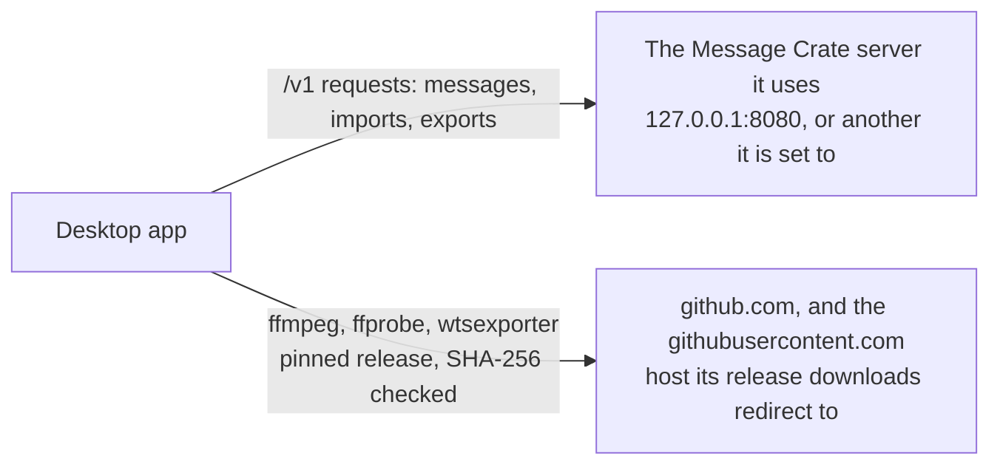

# Outbound connections

This page shows every connection Message Crate makes beyond the computer it
runs on. There are two, both from the desktop app: the Message Crate server
it is set to use, and GitHub, for the three programs in its Tools Directory.
The server and the website connect to nothing on their own. The constraints
a change must keep are in
[Outbound connections: rules](rules/outbound-connections.md), and the
statement for people is on the user guide's page
[What Message Crate is](../src/content/docs/docs/user/try/what-is-message-crate.md),
under "What leaves the computer".

## Who connects to what

| From | To | What for |
|---|---|---|
| The desktop app, `import` and `export` | The server address they are given | Every request of the HTTP interface, and no other host |
| The desktop app | `https://github.com`, which redirects each release download to a `githubusercontent.com` host | The Tools Directory: ffmpeg, ffprobe and wtsexporter, each pinned to one release and one SHA-256 |
| The server | Nothing | It answers requests and reads its own disk |
| The website | Nothing | Its links to messagecrate.app and GitHub open only when clicked |

## How the download works

The check runs in the background at every start and never holds up login or
browsing. A program that is missing or not the pinned release is fetched
from its GitHub release URL. GitHub answers that URL with a redirect to a
`githubusercontent.com` host, and the client follows it, so the bytes come
from there. The file is written under a temporary name in the Tools
Directory, checked against the SHA-256 carried in the app, and only then
renamed over the old one, so a failed download leaves the old program in
use. Why the app downloads these programs rather than shipping them is
[ADR 0019](../adr/0019-the-desktop-app-downloads-the-programs-it-needs.md).

## Where it lives

| Piece | Code |
|---|---|
| The check at start, and what it decides to fetch | `src-tauri/src/tool_downloads.rs` |
| The download itself: the request, the redirect, the temporary file and the checksum | `src-tauri/src/tool_downloads/fetch.rs` |
| The pinned releases and checksums | `src-tauri/src/tool_downloads/pins.rs` |
| wtsexporter's pin, shared with the WhatsApp exporter | `crates/exporters/whatsapp-exporter/src/wtsexporter/pin.rs` |
| The HTTP client `import` and `export` use to reach the server | `crates/libs/http/` |
