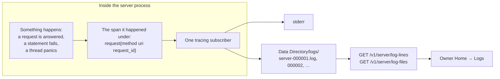

# The server's log

The server keeps a record of its own work: every request it answered, every
failure it met, and what it did at start-up. This page follows one line of
that record from the event that caused it to the owner reading it, and shows
why the pieces sit where they do. The constraints a change must keep are in
[The server's log: rules](rules/server-log.md).

## The shape



Reading left to right:

1. **Something happens.** Code anywhere in the server records it with a
   `tracing` macro: the trace layer when a response goes out, the problem
   builder when a request is refused or fails, the panic hook when a thread
   dies, `serve` as it starts up. Each call is one event with a level and a
   message.
2. **The span it happened under.** A span is the context an event is
   recorded in. Each request runs under a `request` span carrying its
   method, its URI and a request id the server made, and every event
   recorded while the request is answered is tagged with them, including
   events from work the request spawned. Start-up lines have no span.
3. **One subscriber.** A single `tracing` subscriber, installed once at
   start, receives every event with its span and formats it as one line.
   `RUST_LOG` decides which levels it keeps.
4. **Two destinations.** The subscriber writes the same line to stderr,
   where a terminal or Docker shows it, and to the newest file in the
   `logs` directory of the Data Directory. A write that stderr refuses is
   dropped; the file still gets the line.
5. **Three routes.** The owner reads the files back through
   `GET /v1/server/log-lines`, newest first and a page at a time, and
   downloads a whole file through the two `log-files` routes.
6. **The Logs panel.** Owner Home's Logs panel calls those routes and shows
   the lines, filtered by level and by text.

The Message Crate in Docker and the one the desktop app starts are the same
`serve` program with the same Data Directory layout, so both keep the same
files the same way.

## A line

```text
2026-10-08T12:00:00.123456Z  WARN request{method=GET uri=/v1/contacts request_id=3f2a9c6e-7b1d-4e58-9a0f-2c4d8b1e6f70}: The server refused a request problem=invalid-credentials status=401
```

A line is one event: the time in UTC to the microsecond, the level, the span
the event happened under, and what it says. The span is what ties lines
together. The same request id is in the problem document the client
received, so a person who sees a failure on a screen can quote its id and
find every line that request wrote.

A line is always whole. A message that itself contains a line break is
written with the two characters `\n` in its place, and any other control
character is escaped, so a file can be read from any point, forwards or
backwards, and each line found is a complete event. The format is the one
`crates/libs/log-lines` defines, which the desktop app's Import Run logs
share, so one viewer reads both.

## What reaches the log

The server writes at five levels, and the owner's Logs panel opens at
warnings and up.

| Level | What is written there |
|---|---|
| `ERROR` | A `500 Internal Server Error`, with the failing step and the error's whole chain. A panic on any thread. A start-up failure. A response body that failed after its status was sent. |
| `WARN` | A refused request that looks like someone probing: `401 Unauthorized`, `403 Forbidden`, and a database too busy to answer. A refused login, with the account's id and the reason. |
| `INFO` | Every other request: its method, path, status and latency. Every other refusal, with its problem type. What `serve` did at start-up. |
| `DEBUG` | A successful health probe and a successful file of the website, which otherwise bury everything else. |
| `TRACE` | An accepted connection. |

A failed database statement names the step it was doing, in a fixed phrase
such as `read the attachments of a page of messages`, so a `500` line reads
as the step and then the database's own message.

## What never reaches the log

The owner reads this log, and the owner never reads anyone's messages
([ADR 0008](../adr/0008-the-owner-holds-no-messages.md)). So a line holds
outcomes, never content: ids, counts, sizes, times, routes and statuses. A
search's words, a media link, a password, a token, message text, an
attachment's bytes and a contact's name or addresses are not written, and a
request's query string keeps only the values that are numbers, ids or fixed
words; everything else appears as `[hidden]`. A refused request names its
problem type but not the sentence the client was shown, because that
sentence can repeat what a person typed. An integration test runs a real
server through every kind of request and fails if any secret or any content
turns up in the files.

## The files

`serve` opens the log before it opens the database, so the lines that say
why a database could not be opened have somewhere to go. The newest file
takes every line. When a line would carry a file past 50 MB, that file is
closed and the next one starts; when a sixth file starts, the oldest is
deleted. The log is therefore never more than 250 MB, however much a busy
import day writes, and a quiet week deletes nothing. A file keeps its number
for as long as it exists.

The `logs` directory, like the Data Directory around it, is readable by the
user the server runs as and nobody else.

## Reading it back

The owner's Session is the one credential the three log routes accept. The
Logs panel asks for the newest lines first and reads older ones as it
scrolls, filtered by level and by a text search. Each line has an id that
says where it is: its file's number in the high bits and its byte offset in
the low bits, so a larger id is always a newer line, and a page of older
lines is asked for as "the lines before this id". The log is being written
while it is read, which is why pages are addressed by a line rather than by
a count from the top. Each file can also be downloaded whole as plain text.

The panel shows the log as it was when it was read; nothing streams.

## Where it lives

| Piece | Code |
|---|---|
| The subscriber, the panic hook, and opening the files | `crates/server/server/src/logging.rs` |
| Writing and rotating the files | `crates/server/server/src/logging/files.rs` |
| Line ids and reading pages back | `crates/server/server/src/logging/read.rs` |
| The line format, shared with Import Run logs | `crates/libs/log-lines` |
| The request span | `make_span_with` in `crates/server/server/src/server.rs` |
| The request id and spawning under the span | `crates/server/server/src/request_id.rs` |
| What a request's line keeps of its URI, and body failures | `crates/server/server/src/middleware.rs` |
| The problem-type and `500` lines | `crates/server/server/src/problem.rs`, `api_error.rs` |
| The three routes | `crates/server/server/src/server_api/log_lines.rs`, `log_files.rs` |
| The Logs panel | `web/src/screens/owner/OwnerLogsPanel.tsx`, `web/src/components/logs/` |
| The content test | `crates/server/server/tests/server_log.rs` |
