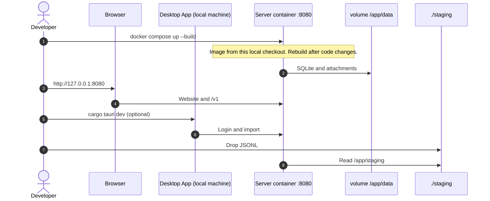

This page is for people who compile Message Crate. It explains how to build a Docker image from a local checkout, what that image contains, and how that build compares to the image CI pushes to Docker Hub.

Everyday coding should just run on the local developer machine. Those steps are on [Contributing → Build and run](/docs/developer/contributing/#build-and-run).

People who only want to run Message Crate, and who are not changing the code, should pull the published image. See [Start a Message Crate](/docs/user/features/owner/run-with-docker/#start-the-server).

Build a local image when the work is about the container itself. Examples:

- A change to `docker/Dockerfile`, `.dockerignore`, or the `demo-seed` crate
- Checking that the website still works when it is compiled into the image, with no Vite server
- Reproducing a Docker Hub build failure before pushing a `v*` tag

:::note
A merge to `main` does not publish an image. CI only builds and pushes `bitrealm/message-crate` when a git tag that starts with `v` is pushed. How versions and tags work is on [Release](/docs/developer/release/).
:::

## Two Compose files

Docker Compose reads a YAML file and starts a container from it. This repository has two of those files. They both publish the server on port **8080** of `127.0.0.1`, so only the computer that runs Docker reaches it, as the `docker run` command in [Start a Message Crate](/docs/user/features/owner/run-with-docker/#start-the-server) does. [Run on another machine](/docs/user/features/owner/run-on-another-machine/#publish-the-server-on-the-network) says how to publish it on the network. They do not do the same thing.

`docker/compose.yml` names an image that already exists: `bitrealm/message-crate:latest`. Compose downloads that image from Docker Hub. It does not compile this local checkout. That file is the sample for [Start a Message Crate](/docs/user/features/owner/run-with-docker/#start-the-server). Do not use that file from a local checkout if the goal is to test local code.

`docker/compose.release.yml` builds `docker/Dockerfile` from the files in this local checkout. The result is the same kind of image CI uploads to Docker Hub: a compiled server binary, the website copied into `static/`, and ffmpeg. After a code change, rebuild. The running container does not pick up edits on the local machine on its own.

A local checkout’s `.env.example` sets `COMPOSE_FILE=docker/compose.release.yml`. After copying that file to `.env`, `docker compose up --build` from the repository root uses the build-from-checkout file. Pass `-f` to override.

Do not run either Compose file at the same time as `./scripts/run-dev.sh`. That script also binds port 8080.

Both files start the container with the same limits. So does every `docker run` command in the user guide that starts the server. It keeps no Linux capability (`cap_drop: [ALL]`), cannot gain one through a setuid program (`no-new-privileges`), and its root filesystem is read-only (`read_only: true`), with `/tmp` in memory for temporary files. The server writes only under `/app/data`, the data volume, so it runs under all three. A test in the server's crate fails when one of the user guide's `docker run` commands leaves out a limit.

Both files also set `stop_grace_period: 40s`.
A stopping server waits up to 30 seconds for the requests in flight, such as an import batch, and for its conversions to stop, before it stops without them (`STOP_DRAIN_LIMIT` in `crates/server/server/src/server.rs`).
Docker's default of 10 seconds would kill it part-way, with no line in the log saying why.
The 10 seconds more leave time for the server to write its log and exit after its own limit, so Docker never has to kill it.
The documented `docker run` commands carry the same 40 seconds as `--stop-timeout 40`, and a test in the server's crate fails when a Compose file or one of those commands gives no more than the server's limit.

A change that makes the server write anywhere else fails with a read-only file system error: at start, the container stops, and during an import or an export, that work fails. `scripts/check-docker-compose.sh` starts `docker/compose.release.yml` on a built image, checks the limits are in force, and logs in to the Demo Account, which catches a write at start.
It then claims the Message Crate, creates an account, and imports one conversation with an HEVC video through `/v1`, because the Demo Account may not import.
It waits for the media pass to make the video's Thumbnail and Preview, and runs an Export of everything the account holds, so a write made during an import, the media pass or an export fails it too.
The conversation is `tests/fixtures/docker-compose-check/conversation.jsonl`, and the video is the server's test fixture `crates/server/server/tests/fixtures/media/hevc.mov`.
Last, it stops the stack and fails when the server did not exit on its own, so a server that outlives the `stop_grace_period` and is killed by Docker fails it.
CI's "Docker image builds" job and the nightly build run it.
A pull request runs the job only when it changes what the image is built from (the Dockerfile, a Cargo manifest, the lockfile, the toolchain pin) or the check and its fixtures.
A change to the server's code alone is caught by the nightly build on `main`, not on the pull request.
The stack runs under its own Compose project, `message-crate-compose-check-<host-port>`, and its own volume, so it never touches a running Message Crate, and the script removes it on exit.

`--website` adds a check of the website the container serves, because the web app's tests mock the server and the server's tests never load the website.
It runs `scripts/check-served-website.sh`, which opens the website in headless Chromium inside the Playwright image, logs in to the Demo Account, searches the conversation list, and opens a conversation the search found.
The search term is a word from a conversation name on the list, chosen by `scripts/website-check/check.mjs` so the search finds fewer conversations than the whole list.

The check fails when the search finds nothing, finds no fewer conversations than the whole list, or opens a conversation it did not find.
It also fails when a screen does not appear, when the browser logs a console error or an uncaught exception, or when the server answers any request with a 5xx server error status.
The nightly build passes `--website`, and CI's job leaves it out, because every run would pull the Playwright image, `mcr.microsoft.com/playwright`, which is about 2.5 GB unpacked.

The script takes a built image, an optional host port (18080 unless given), and `--website` before, between, or after those two.
It refuses any other argument that starts with `-`, so a mistyped option is never taken for the image or the port.

```bash title="Build the release image and run the nightly check on it"
# Build the release image under a local tag, so the check never runs an image pulled from Docker Hub
docker build -f docker/Dockerfile -t message-crate-server:check .
# Start it on 127.0.0.1:18080, the default with no port given, and run the browser check against it
./scripts/check-docker-compose.sh --website message-crate-server:check
```

The check needs Docker with Compose 2.24.4 or later, `jq`, and `curl` on the local machine, and nothing else, because npm installs the browser driver inside the Playwright image.
Compose 2.24.4 is the first release that reads the `!override` tag the script writes into its override file.

The Playwright container uses the host's network to reach the server at `127.0.0.1`.
That works with Docker Engine on Linux.
Docker Desktop puts a host-network container on its own virtual machine, where `127.0.0.1` is not the local machine.
Docker Desktop 4.34 and later can share the local machine's network instead, once host networking is turned on in its settings.

`./scripts/check-served-website.sh <base-url>` runs the browser check alone against any running Message Crate that serves the built website and holds the Demo Account, such as the release Compose stack at `http://127.0.0.1:8080`.
A server started by `./scripts/run-dev.sh` serves only the API, because the Vite server on port 5173 serves the website there.
The check fails at its first page against it.

## What the image contains

The container is the server process only. The desktop app stays on the local machine and talks to the server over HTTP.

| Piece | Role |
|---|---|
| `message-crate-server` | HTTP API under `/v1/*` and the website on port **8080** |
| SQLite | Database and attachments under `/app/data` |
| ffmpeg | Converts media so the browser can play it |

The website in the image is the production Vite build from `web/`. There is no Vite dev server inside the container.

## How `docker/Dockerfile` builds

The file has three stages. Each stage is a temporary image. Only the last stage is what you run.

1. **Website.** Node.js 24 installs `web/` dependencies and runs `npm run build`. The output is `web/dist`.
2. **Server binary.** Rust 1.98.1, the version `rust-toolchain.toml` pins, compiles `message-crate-server` in release mode. The binary carries what it needs to generate Demo Data: the `demo-seed` crate, its two size settings, the Pride and Prejudice text, and the name lists.
3. **Runtime.** A slim Node.js 20 image gets ffmpeg, the server binary, `config/config.docker.toml` as `config/config.toml`, and the website files copied to `static/`. Its `HEALTHCHECK` runs `docker/healthcheck.cjs` with Node every 30 seconds, and every 2 seconds during its five-minute start period, which covers the Demo Account seed on a first start. The script reads the address the server listens on from `/proc` and asks `/health` there, so it follows `[server] bind` and `serve --bind`. `/health` answers `ok` only while the server can take a database connection and run a statement on it, so a server that runs but cannot reach its database reads unhealthy. A container whose command is not `serve`, such as `reset-demo` or `create-owner`, or that runs no server at all, passes the check, because nothing in it is meant to answer. The script's header comment has the details.

The build context is the **repository root**. `.dockerignore` decides what Docker sends into that context. It must ignore the live data directory at the repo root (`/data`) so a personal database is not copied into the image. It must not ignore `crates/server/demo-seed/data/`. That directory holds the Pride and Prejudice text and the name lists the server compiles in.

## Build from this local checkout

Work from the repository root. Docker Desktop or Docker Engine with Compose v2 is required.

### Before you start

Copy [`.env.example`](https://github.com/messagecrate/message-crate/blob/main/.env.example) to `.env` if Compose should read `UID`, `GID`, and `COMPOSE_FILE` from the repository root.

`UID` and `GID` are the numeric user and group on this machine. Setting them to `id -u` and `id -g` keeps files the container writes owned by the account that started Compose.

### Build and start

This is the usual local path. Compose compiles `docker/Dockerfile` and starts the container.

```bash title="Build and start from this local checkout"
docker compose -f docker/compose.release.yml up --build
```

The server is at **http://127.0.0.1:8080**. On a data volume with no database, the server adds the Demo Account with the medium data set (about 54,000 messages) before it listens, and leaves Message Crate unclaimed. The first screen offers **Create Owner** and **Explore Demo Account**; the Demo Account has no password. There is no switch for this: a Message Crate started by Docker begins the same as any other.

The container's entrypoint only runs `serve`, and writes nothing. Arguments after the image name run another server command in its place, with the stack stopped.

### Build without starting

Use this when the image should be compiled but not run yet.

```bash title="Build only, do not start"
docker compose -f docker/compose.release.yml build
```

### Match the CI build

CI builds `docker/Dockerfile` from the repository root. It does not use Compose. The shortest local equivalent is:

```bash title="Build with docker build"
docker build -f docker/Dockerfile -t bitrealm/message-crate:local .
```

CI uses Buildx and then pushes to Docker Hub. Locally, omit the push. To include the same optional build argument CI passes:

```bash title="Build with Buildx, load onto this machine"
docker buildx build \
  -f docker/Dockerfile \
  -t bitrealm/message-crate:local \
  --build-arg BUILD_METADATA= \
  --load \
  .
```

`--load` stores the image on this machine. CI uses push instead.

### Load the large data set

```bash title="Rebuild the Demo Account with about 613,000 messages"
docker compose -f docker/compose.release.yml down
docker compose -f docker/compose.release.yml run --rm server reset-demo --size large
docker compose -f docker/compose.release.yml up
```

### Start with no Demo Account

```bash title="Create the database empty, then start"
docker compose -f docker/compose.release.yml run --rm server create-database
docker compose -f docker/compose.release.yml up
```

This works on a new volume only. `create-database` leaves an existing database as it is.

### Point `cargo tauri dev` at the container

The image allows no Vite origin, because one would let any page on port 5173 of the viewer's computer call the server.
`cargo tauri dev` loads its window from `http://localhost:5173`, so the container needs that origin passed to `serve` with `--cors-origin`.
The stack must be stopped first, because the run publishes port 8080 and fails while the stack holds it.

```bash title="Serve with the Vite origin allowed"
docker compose -f docker/compose.release.yml down
docker compose -f docker/compose.release.yml run --rm --service-ports \
  server serve --config config/config.toml --cors-origin http://localhost:5173
```

### Rebuild without cache

Use this after a failed build that used an old `.dockerignore`. Docker may otherwise reuse a layer that omitted `demo-seed` data files.

```bash title="Rebuild without cache"
docker compose -f docker/compose.release.yml build --no-cache
```

### After the container is running

Browse and search work in the browser against the container. The desktop app is optional. Importing a phone backup still needs the desktop app on the local machine.



## What CI builds

On a `v*` tag, the **Docker image** job in `.github/workflows/ci.yml` runs after the Rust tests pass. It builds `docker/Dockerfile` with context `.` (the repository root) and pushes:

- `bitrealm/message-crate:<version>` — for example `0.10.0`, with no `v`
- `bitrealm/message-crate:<major>.<minor>` — for example `0.8`
- `bitrealm/message-crate:latest`

A release never pushes `sha-<commit>`. That tag belongs to the manual run below, so it always names an image that reports the commit in its Build.

The same job can push an image without a release. Start the CI workflow by hand on any branch with **push_docker_image** ticked:

```bash
gh workflow run ci.yml --ref <branch> -f push_docker_image=true
```

The run goes through every CI job first, and then pushes `bitrealm/message-crate:sha-<commit>` alone. It does not move `latest` or a version tag, so the image people pull stays the released one. The server in that image reports its Build, the Product Version with the commit, for example `0.9.0+343fe0d8`.

That job is the Hub image. `docker/compose.release.yml` is the way to compile the same Dockerfile on a local machine. Pulling `bitrealm/message-crate:latest` is not a test of uncommitted Dockerfile changes.

## Run the published image

Pull and start `bitrealm/message-crate` from Docker Hub as described in [Start a Message Crate](/docs/user/features/owner/run-with-docker/#start-the-server). That page gives the `docker run` command; `docker/compose.yml` in the repository is the Compose form of it, with the same limits, described under [Two Compose files](#two-compose-files). Upgrades that keep the existing database volume are on [Update](/docs/user/features/owner/update/).

## Related

- [Contributing](/docs/developer/contributing/#build-and-run)
- [Release](/docs/developer/release/)
- [Start a Message Crate](/docs/user/features/owner/run-with-docker/)
- [Update](/docs/user/features/owner/update/)
- [HTTP API](/docs/developer/reference/api/)
- [Config and accounts](/docs/developer/reference/config-and-accounts/)
