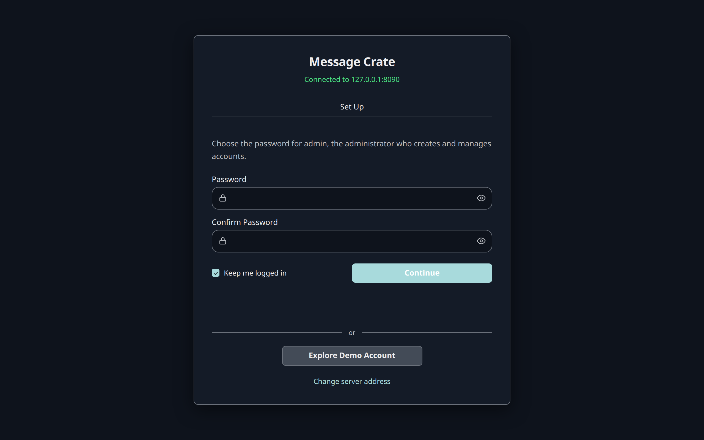

The desktop app starts a Message Crate of its own, which runs while the app is open.
Docker runs one that stays on: after a restart, with the app closed, and on a computer nobody sits at.
It is the same server either way, with the same first screen, the same Demo Account, and the same Owner Home.

The two don't share messages.
A Message Crate started here begins with demo data only, and the Owner, the accounts, and the imports are made in it as in [Your own messages](/docs/user/your-messages/create-the-owner-and-an-account/).

## Install Docker

The server is published as a Docker image.

- **Windows and macOS:** [Docker Desktop](https://docs.docker.com/desktop/). Docker Desktop must be running before the command below works.
- **Linux:** [Docker Engine](https://docs.docker.com/engine/install/).

`docker --version` in a terminal prints a version number once Docker is installed.

## Check the image

This step is optional.
The image carries a build provenance attestation: a signed record, kept by GitHub, that ties it to the run of Message Crate's release workflow that built it.
Releases from 0.11.0 on carry one. Earlier releases don't.
The [GitHub CLI](https://cli.github.com/) checks it, once `gh auth login` has logged it in to a GitHub account:

```bash
gh attestation verify oci://docker.io/bitrealm/message-crate:latest --repo messagecrate/message-crate
```

It reports that verification succeeded, and names the workflow and the tag, when the image is one that workflow built.
A version tag in place of `latest`, such as `0.11.0`, checks that release.

## Start the server

```bash title="Start a Message Crate"
docker run -d --name message-crate \
  --stop-timeout 40 \
  --restart unless-stopped \
  --cap-drop ALL \
  --security-opt no-new-privileges:true \
  --read-only \
  --tmpfs /tmp \
  -p 127.0.0.1:8080:8080 \
  -v message-crate-data:/app/data \
  bitrealm/message-crate:latest
```

On Windows, PowerShell needs the command on one line, without the trailing `\` characters.

What each part does:

| Part | Meaning |
|---|---|
| `--name message-crate` | Names the container, so later commands can refer to it. |
| `--stop-timeout 40` | Gives the server 40 seconds to stop. A stopping server waits up to 30 seconds for the work in progress, such as an import, and Docker's own 10 seconds would cut that wait short. |
| `--restart unless-stopped` | Starts the server again after the computer restarts. |
| `--cap-drop ALL` | Takes away every Linux capability, the special permissions a container keeps by default. The server needs none of them. |
| `--security-opt no-new-privileges:true` | Stops a program in the container from gaining more permissions than it started with, such as through a setuid program. |
| `--read-only` | Makes the container's own files read-only. The server writes only to the volume below and to `/tmp`. |
| `--tmpfs /tmp` | Gives the server a writable `/tmp` for temporary files, kept in memory and emptied when the container stops. |
| `-p 127.0.0.1:8080:8080` | Makes the server reachable at port 8080 from this computer only. |
| `-v message-crate-data:/app/data` | Keeps the database in a Docker volume named `message-crate-data`. |

The four limits change nothing the server does.
They narrow what a program that breaks into the container could do there.

Every message this Message Crate holds lives in the `message-crate-data` volume.
`docker rm message-crate` removes only the server and keeps the messages.
`docker volume rm message-crate-data` deletes the messages.

## Wait for the first start

The first start writes the demo data before the server answers, which takes a few seconds.
`docker logs -f message-crate` shows the progress.
The server is ready when the log prints `listening on`.
`Ctrl+C` stops following the log and leaves the server running.

Later starts write nothing and answer at once.

## Check that it worked

[http://localhost:8080](http://localhost:8080) in a browser shows a card titled **Message Crate**, with the line **Connected to localhost:8080**, a **Create Owner** form, and an **Explore Demo Account** button.



Is port 8080 already in use?

Docker then reports `port is already allocated` and the container doesn't start.
`docker rm message-crate` removes the failed container.
Changing the first `8080` in the command to a free port, such as `-p 127.0.0.1:8090:8080`, moves the server to `http://localhost:8090`.

## Connect the desktop app

Importing needs the desktop app.
On the same computer the app finds this Message Crate at its usual address and starts no server of its own.
For a Message Crate on another computer, **Change server address** on the app's first screen takes its address; [Run on another machine](/docs/user/features/owner/run-on-another-machine/) has the steps.
