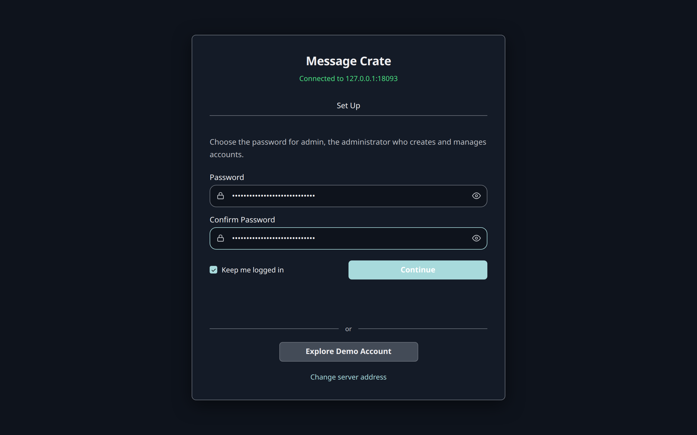
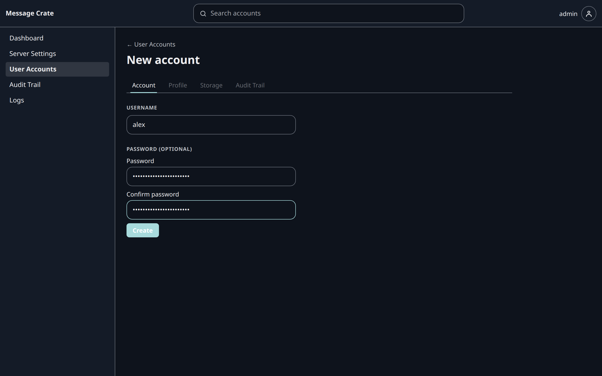
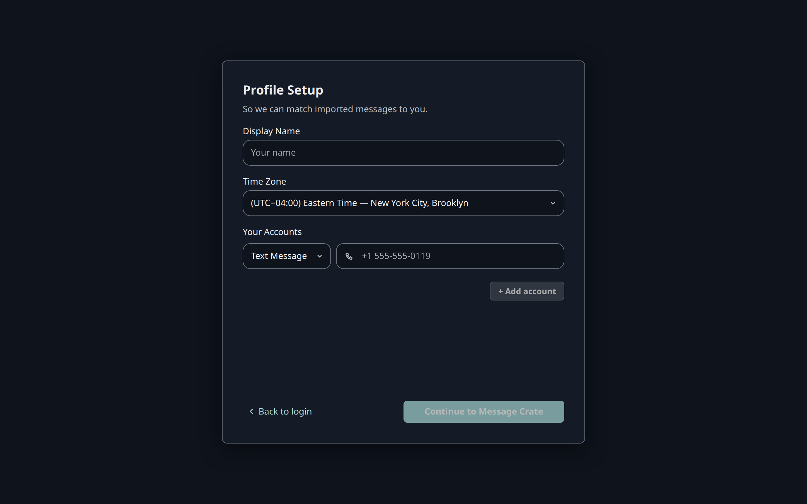

This step makes the Message Crate the desktop app started ready for real messages, and ends logged in as the account that will hold them.

It uses two logins, and both are needed:

- **The administrator**, `admin`, runs the Message Crate. It adds accounts and changes server settings. It holds no messages and can't import any. Every Message Crate has `admin` from the start, with no password until one is chosen.
- **An account** holds one person's messages and contacts. Import, search, and export all happen in an account.

The split means the person who runs the server can't read another person's messages through it.
The person who runs a Message Crate for themselves still needs both.

Real messages never go into the Demo Account. It can't import, so that no backup lands among the made-up conversations.

## Set up the administrator

1. Open the desktop app. A Message Crate whose administrator has no password yet shows **Set Up**. Whoever fills it in first chooses the administrator's password.
2. Enter a **Password**, and repeat it in **Confirm Password**. There is no username to enter, because the administrator is always `admin`. A password is at most 128 characters.
3. Select **Continue**.

The app opens **Admin Home** on **User Accounts**, which lists `admin` and **demo**, the Demo Account.
The first screen now shows **Login** in place of **Set Up**, and keeps **Explore Demo Account** while the Demo Account exists.

Choose a password that is used nowhere else: the administrator manages every account on this Message Crate.

## Add an account

1. On **User Accounts**, select **Add account**.
2. Enter a **Username**.
3. Enter a **Password** and repeat it in **Confirm password**. The form allows an account with no password, but such an account can't log in until the administrator sets one, so give it one now. A password is at most 128 characters.
4. Select **Create**.

The screen changes to **User Settings** for the new account.
Under **Message Permissions**, **Import**, **Export**, and **Delete** are all on, which is what importing needs.

Only the administrator creates accounts.
The login screen has no way to make one, so a stranger who reaches the server can't make themselves an account.

## Log in as the account

1. Open the account menu, the round button at the top right, and select **Log out**.
2. Log in with the new account's username and password.

The first login opens **Profile Setup**:

- **Display Name** is the name shown on messages this person sent.
- **Time Zone** is the zone every message time is shown in.
- **Your Accounts** takes this person's own phone numbers and email addresses. Import uses them to tell sent messages from received ones, so the phone number of the phone being imported belongs here. More can be added later in **Settings**.

Each row under **Your Accounts** has a type, **Text Message**, **Email**, or **WhatsApp**, and a value.
**Continue to Message Crate** stays grayed out until **Display Name** and at least one row under **Your Accounts** are filled in, because Import has nothing to match sent messages against without an address.
Selecting it then opens the conversation list, which is empty.

## Check that it worked

The app shows **No conversations**, logged in as the new account.
The left panel has **Import** and **Export**, which a browser doesn't show.

Next: back up the phone. [iPhone](/docs/user/your-messages/back-up-an-iphone/) or [Android](/docs/user/your-messages/back-up-an-android-phone/).
